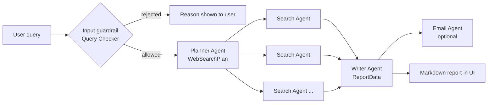

# Deep Research Agent

A multi-agent web research assistant built with the [OpenAI Agents SDK](https://openai.github.io/openai-agents-python/).
Give it a research question and it checks the query with an input guardrail, plans a set of web
searches, runs them in parallel through [Tavily](https://tavily.com), writes a long-form Markdown
report, and (optionally) emails it to you. Progress is streamed live in a Gradio UI.

## Architecture



| Agent | File | Role |
|---|---|---|
| Query Checker | `guardrails.py` | Input guardrail that blocks small talk, prompt-injection attempts and harmful requests before any research runs |
| Planner Agent | `planner_agent.py` | Turns the query into `HOW_MANY_SEARCHES` targeted web searches (structured output) |
| Search Agent | `search_agent.py` | Calls the Tavily search tool and summarises the results; runs concurrently, one per planned search |
| Writer Agent | `writer_agent.py` | Synthesises all summaries into a detailed Markdown report with a summary and follow-up questions |
| Email Agent | `email_agent.py` | Converts the report to HTML and sends it over SMTP (skipped when `USE_EMAIL=false`) |

`research_manager.py` orchestrates the pipeline, and every run is recorded as an OpenAI trace
(the trace link is shown in the UI).

## Features

- **Input guardrail** that runs before the planner, so rejected queries cost one small model call
- **Parallel searches** with `asyncio.gather`; a failed search is skipped instead of failing the whole run
- **Structured outputs** (Pydantic) between agents
- **Streaming status updates** in the Gradio UI
- **Optional email delivery** of the finished report
- **Tracing** of every run in the OpenAI platform

## Getting started

### Prerequisites

- Python 3.12+
- An [OpenAI API key](https://platform.openai.com/api-keys)
- A [Tavily API key](https://app.tavily.com)

### Install

With [uv](https://docs.astral.sh/uv/) (recommended):

```bash
uv sync
```

Or with pip:

```bash
pip install -r requirements.txt
```

### Configure

```bash
cp .env.example .env
```

Then fill in your keys in `.env`:

| Variable | Required | Default | Description |
|---|---|---|---|
| `OPENAI_API_KEY` | yes | | OpenAI API key used by all agents |
| `TAVILY_API_KEY` | yes | | Tavily API key for web search |
| `DEFAULT_MODEL_NAME` | no | `gpt-5.4-mini` | Model used by every agent |
| `HOW_MANY_SEARCHES` | no | `5` | Number of searches the planner creates |
| `USE_EMAIL` | no | `true` | Set to `false` to skip emailing the report |
| `EMAIL_ADDRESS` | if email on | | Sender and recipient address |
| `EMAIL_SMTP_SERVER` | if email on | | SMTP server (port 587, STARTTLS), e.g. `smtp.gmail.com` |
| `EMAIL_APP_PASSWORD` | if email on | | SMTP app password |

### Run

```bash
uv run app.py
```

Or, if you installed with pip:

```bash
python app.py
```

Then open the local URL Gradio prints (usually http://127.0.0.1:7860).

## Deploying to Hugging Face Spaces

The frontmatter at the top of this README configures a Gradio Space. Create a Space from this
repository and add `OPENAI_API_KEY`, `TAVILY_API_KEY` (and the email settings, or `USE_EMAIL=false`)
as Space secrets.

## Project structure

```
app.py               Gradio UI
styles.py            UI CSS, JS and example queries
research_manager.py  Pipeline orchestration
guardrails.py        Input guardrail (Query Checker agent)
planner_agent.py     Search planning
search_agent.py      Tavily web search tool + summariser
writer_agent.py      Report writer
email_agent.py       Email formatting agent
messenger.py         SMTP helper
```
